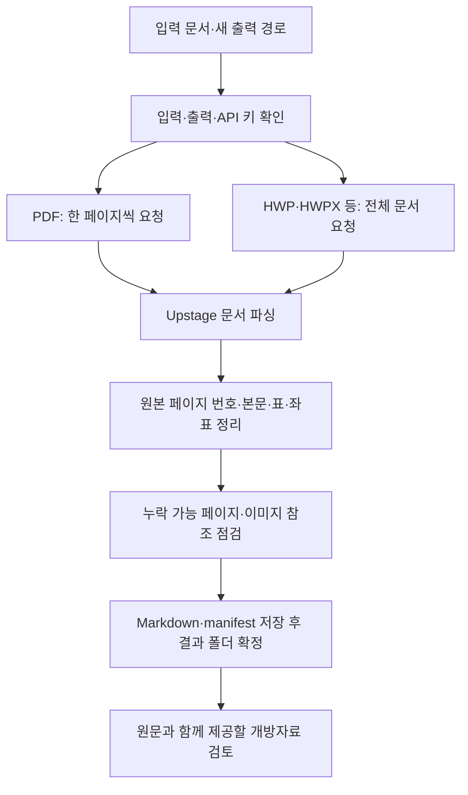

# 문서 파싱을 통한 AI 활용용 개방자료 준비

기관 문서의 본문과 표를 페이지별 Markdown으로 변환하고 원본 페이지와 연결해, 기계학습에 활용하기 쉬운 개방자료를 준비하는 도구다.

## 실제 업무 목적

행정안전부 주관 공공데이터 제공운영 및 데이터기반행정 평가의 공공데이터 제공운영 영역에는 **‘AI 친화·고가치 데이터 개방 노력’** 지표가 있다. 국민·기업의 활용 수요가 높고 문제 해결에 도움이 되는 데이터를 개방하기 위한 기관의 노력을 평가하는 지표다.

이 업무에서는 기관 문서를 기계학습에 유용한 형태로 파싱하고, 원문과 파싱 결과를 함께 개방하는 방안이 제시되었다. 이 코드는 그 방안에 맞춰 문서를 변환하고 결과를 정리하기 위해 작성했다. 지표의 위치는 [평가지표 연결표](../reference/records/gonggam-data/evaluation/indicators-2026.md)에서 확인할 수 있으며, 코드의 업무 목적은 사용자 설명에 근거한다.

파싱 결과의 본문·표·페이지 대응을 검토해 개방자료를 준비하는 데 활용한다. 특정 기관의 개방 완료 건수나 평가 성과를 뜻하지는 않는다. 실제 문서의 추출 정확도와 함께 제공할 자료의 범위는 별도로 검토한다.

## 처리 흐름



`parse.py`는 실행 흐름, `config.py`는 설정과 입력 검사, `client.py`는 API 요청과 응답 해석, `storage.py`는 결과 점검과 저장을 담당한다. 기본 모델은 `document-parse`, OCR은 `force`, 출력은 페이지별 Markdown이다.

## 최소 사용법

Python 3.13 가상환경에서 의존성을 설치하고 실행한다. API 키는 `UPSTAGE_API_KEY` 환경 변수 또는 `--env-file`로 지정한 UTF-8 파일에서 읽는다. 환경 변수 값이 우선하며, 키를 명령 인수로 전달하지 않는다.

```powershell
python -m pip install -r requirements.txt
python -B parse.py --input "document.hwpx" --output "outputs/result" --env-file .env
```

실행 시 입력 문서는 Upstage API로 전송된다. 상대 경로는 명령을 실행한 폴더 기준이다. 입력은 HWP·HWPX·PDF·DOCX·PPTX·XLSX 및 지원 이미지 형식을 받는다. 출력 경로는 존재하지 않는 새 폴더여야 하며 기존 결과를 덮어쓰지 않는다.

`--model`, `--ocr force|auto`, `--timeout`으로 요청 설정을 바꿀 수 있다. 기본 제한 시간은 요청당 300초이며, 자동 재시도는 하지 않는다. PDF는 페이지별로 처리하고 다른 형식은 전체 파일을 한 번 요청한다. 별도의 서버 비동기 작업 API를 사용하는 방식은 아니다.

## 결과를 활용할 때

- `parsing_page_원본번호.md`: 원본 페이지 번호를 유지한 본문·표. 응답에 없는 페이지를 당겨서 다시 번호 매기지 않는다.
- `manifest.json`: 원본과 결과의 해시, 페이지·파일 대응, 요청 설정과 반환 모델, 좌표, 누락 가능 페이지와 이미지 참조 검토 항목.

모든 결과가 저장된 뒤 새 출력 폴더를 확정한다. 빈 전체 응답이나 오류에서는 완료 폴더를 만들지 않는다. 일부 페이지에 내용이 없으면 빈 페이지인지 추출 누락인지 검토하도록 기록한다. 전체 페이지 수를 확인할 수 없을 때는 그 한계도 표시한다.

이미지 파일은 별도로 추출하지 않는다. 일반 Markdown·HTML의 로컬 이미지 참조는 미해결, 외부 이미지 주소는 미확인으로 기록하고 자동으로 접속하지 않는다. 복잡한 이미지 문법과 추출 내용은 원문과 함께 검토한다.

종료 코드는 저장 완료 `0`, 결과 저장 후 검토 필요 `1`, 실행 실패 `2`다. `complete` 상태는 저장과 자동 점검 결과를 나타내며 OCR 정확도나 개방자료의 최종 적합성을 보증하지 않는다.
