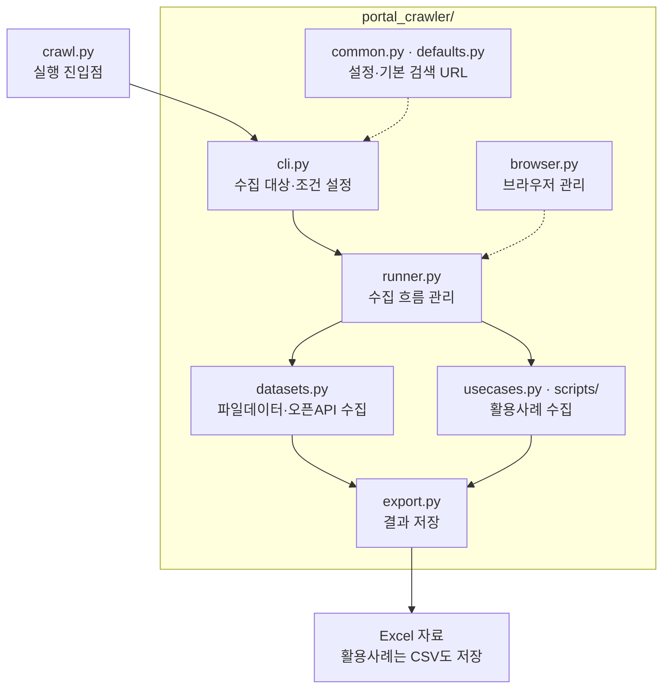

# 공공데이터포털 정보 수집 및 업무 자료 정리

공공데이터포털의 정보를 수집해 개방현황 정보를 **Excel 자료로 정리하고, 후속 자료 작성과 의사결정에 활용하기 위해** 사용한 코드이다.

## 사용 목적과 업무 활용

업무에 필요한 공공데이터 목록, 오픈API 현황, 활용사례 정보를 포털에서 수집한다. 수집한 내용을 Excel로 정리한 뒤 이를 바탕으로 각종 자료를 만들거나 의사결정에 참고했다.

세 수집 기능은 대상에 따라 나뉘며, 포털 정보를 업무에 활용할 수 있는 자료로 정리한다는 공통 목적을 갖는다.

| 수집 대상 | 정리하는 정보 |
|---|---|
| 파일데이터 목록 | 데이터명, 제공기관 등 |
| 오픈API 현황 | 데이터명, 제공기관, 조회수와 활용신청 건수 등 |
| 공공데이터 활용사례 | 서비스명, 서비스 설명·URL, 활용한 데이터 목록 등 |

## 코드 구조

수집 대상별 처리는 분리하고, 실행 설정·브라우저 관리·결과 저장은 함께 사용한다.



## 간단한 실행

Python과 Chrome이 설치된 환경에서 이 폴더를 기준으로 실행한다.

```powershell
python -m pip install -r requirements.txt
python crawl.py --target file
```

수집 대상은 `file`·`api`·`usecase` 중 선택한다. 기본 출력은 `outputs/`에 저장되며, 검색 조건 등 추가 옵션은 `python crawl.py --help`에서 확인할 수 있다.
