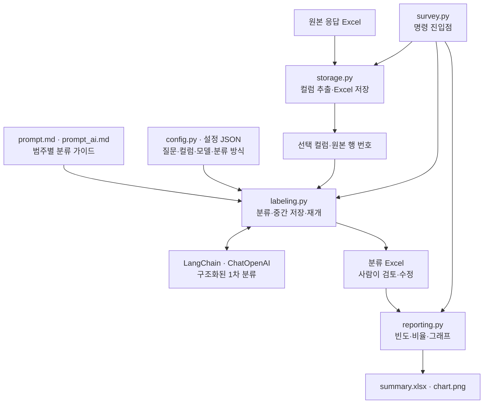

# 설문 주관식 응답 분류

공감데이터 재직 중 **대국민 공공데이터 활용 수요조사의 주관식 응답을 분류하고, 결과보고서에 사용할 집계와 시각화를 만드는 데** 사용한 코드입니다. 기관이 파악하려는 공공데이터 개선 의견과 AI 서비스 개발을 위한 개방 수요를 정리하는 업무를 지원합니다.

## 업무 활용

실제 업무에서는 수집한 응답을 정리해 분류체계를 만들고 LangChain으로 1차 분류한 뒤 사람이 재검토했습니다. 검토된 분류를 수치화하고 대표 답변을 선정하여 결과보고서에 반영했습니다. 담당했던 대부분 기관의 주관식 응답에 이 처리 방식을 적용했다는 설명은 [수요조사 업무 기록](../reference/records/gonggam-data/work/public-data-demand-survey.md)에 근거합니다.

이 코드는 주관식 컬럼 추출, 1차 분류, 검토 결과의 집계·시각화를 담당합니다. 설문 설계·홍보·객관식 분석·대표 답변 선정·보고서 집필은 사람이 수행한 업무이며 코드가 자동으로 처리하는 범위에 포함하지 않습니다. 활용지원 지표의 평가 결과를 분류 정확도나 처리시간 개선 성과로 해석하지 않습니다.

| 분류 방식 | 활용 목적 | 분류·집계 기준 |
| --- | --- | --- |
| `general` | 공공데이터 개방·활용에 관한 일반 의견 정리 | 기본 7개 범주에서 하나 이상 선택. 범주 할당 건수를 분모로 비율을 계산하고 소수점 1자리로 표시. 기타를 포함한 원형 차트 |
| `ai` | AI 서비스 개발에 필요한 개방 데이터 수요 정리 | 기본 9개 범주에서 하나 선택. 분류된 응답 건수를 분모로 계산하며 Excel 비율을 반올림하지 않음. 집계표에는 기타를 포함하고 막대 차트에서는 제외 |

일반 의견은 한 응답에 여러 범주를 부여할 수 있으므로 **범주 비율과 응답자 비율이 다릅니다.** 기본 AI 범주는 여성폭력·인권 관련 문항의 예시이며, 모든 기관에 공통으로 적용하는 최종 분류체계가 아닙니다. 기관·문항에 맞는 질문과 분류 가이드를 먼저 확정해야 합니다.

## 코드 구조



## 간단한 실행

Python 3.13 환경에서 이 폴더를 작업 디렉터리로 사용합니다. 원본은 `inputs/`, 결과는 `outputs/`에 두고 예제 JSON을 `config.local.json`으로 복사하여 실제 문항의 `question`, `answer_column`, `id_column`을 설정합니다. 예제의 질문은 사용법 설명용이며 실제 기관 설문 원문이 아닙니다.

```powershell
python -m pip install -r requirements.txt
python survey.py extract --input inputs/responses.xlsx --output outputs/selected.xlsx --columns "응답번호" "의견" "AI수요"
python survey.py classify --input outputs/selected.xlsx --output outputs/classified.xlsx --config config.local.json
python survey.py summarize --input outputs/reviewed.xlsx --output outputs/report --config config.local.json
```

`reviewed.xlsx`는 분류 결과를 사람이 확인·수정한 파일입니다. 일반 의견은 `config.general.example.json`, AI 수요는 `config.ai.example.json`을 기준으로 설정합니다. 원본에 필요한 컬럼이 이미 있으면 추출 단계를 생략할 수 있습니다. 여러 문항은 설정과 출력 경로를 구분해 각각 분류합니다.

- **입력:** 첫 행에 고유한 컬럼 이름이 있는 `.xlsx` 파일. 수식은 값으로 확정한 별도 입력을 사용합니다. 식별자 컬럼은 선택 사항이며 `id_column`을 생략할 수 있습니다. 응답 외 컬럼의 결측 때문에 행을 버리지 않습니다.
- **분류 설정:** 기본 모델은 `gpt-4o-mini`, 요청 제한 시간은 60초입니다. `model`, `timeout`, `sheet`를 설정할 수 있습니다. 범주를 바꾸려면 `categories` 목록과 `prompt_path`를 함께 지정하고, 프롬프트의 `- 범주 : 설명` 목록을 같은 순서로 작성합니다. 프롬프트 변수는 `{question}`, `{answer}`입니다. 상대 프롬프트 경로는 설정 JSON 위치를 기준으로 합니다.
- **API 키:** 실제 분류 요청에는 `OPENAI_API_KEY`가 필요합니다. 환경 변수를 우선하며 `--env-file`을 명시한 경우에만 해당 파일을 읽습니다. 추출·집계·빈 응답 처리에는 키가 필요하지 않습니다. 자동 재시도는 하지 않습니다.
- **출력 보호:** 기존 경로를 자동 덮어쓰지 않습니다. 분류 파일의 `responses` 시트에 원본 컬럼, `source_row`, `category`, `status`, `error_code`를 저장하고 `run` 시트에 재개 확인용 정보를 남깁니다. 문자열을 Excel 수식으로 바꾸거나 긴 원문을 자동으로 자르지 않습니다.
- **사람 검토:** `category`를 확인·수정합니다. 복수 범주는 `홍보, 신규개방`처럼 쉼표로 구분합니다. `status`가 있는 파일은 `completed` 행만 집계하며, 수동으로 분류를 완료한 행은 상태도 확정합니다. `category`만 있는 별도 검토 파일도 집계할 수 있습니다. 미완료·빈 분류 건수와 분모는 집계표의 `details` 시트에 남습니다.
- **그래프:** 기본은 PNG 저장이며 `--show`를 주면 창도 표시합니다. 한국어 폰트를 자동 선택하고, 필요하면 `--font`로 파일을 지정합니다. 명령별 추가 옵션은 `--help`에서 확인합니다.

분류가 중단되면 같은 입력·설정을 사용해 미완료 행만 재개합니다. 원본·질문·프롬프트·모델 설정이 달라지면 새 출력으로 시작합니다. 재개 중에는 결과 파일을 다른 프로그램에서 수정하지 않습니다.

```powershell
python survey.py classify --input outputs/selected.xlsx --output outputs/classified.xlsx --config config.local.json --resume
```

`completed`는 자동 분류 저장 완료를 뜻하며 사람의 검토 완료를 인증하지 않습니다. 빈 응답은 `skipped`, 미처리는 `pending`, 실패는 `error`입니다. 분류 중 첫 오류가 발생하면 해당 행 상태를 저장하고 멈춥니다. 종료 코드 `0`은 명령 완료, `1`은 분류 오류·미처리 행이 남음, `2`는 실행 실패입니다.

업무 적용 설명과 현재 코드의 실행 검증은 구분합니다. 실제 API 응답 품질·기관 데이터 처리·정확도·시간 절감은 이번 검증 대상이 아니며, 실행 조건과 검증 한계는 [검증 기록](VALIDATION.md)에서 확인할 수 있습니다.
