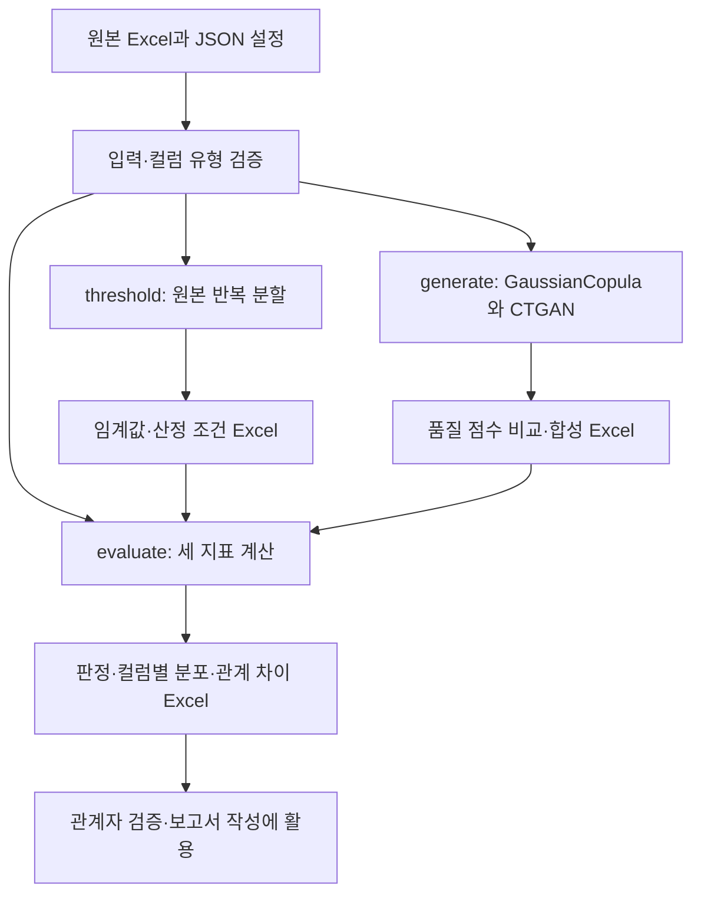

# 합성데이터 생성·평가

원본 표의 통계적 특성을 학습해 합성데이터를 만들고, 생성 결과를 검토할 지표와 임계값을 Excel로 정리하는 도구다. 기관 데이터의 합성 후보를 검토한 뒤 컬럼 처리 방안을 정하고, 생성·평가 결과를 관계자 검증과 보고서 작성에 연결하는 업무에 사용한다.

## 사용 목적과 업무 활용


행정안전부 주관 **공공데이터 제공운영 및 데이터기반행정 평가**의 ‘**가명정보 제공 및 합성데이터 개방 실적**’ 지표 대응을 위해 기관의 데이터를 대상으로 합성데이터를 생성하고 평가하는 코드를 작성하였다.

이 도구는 **개인정보보호위원회의 '합성데이터 생성·활용 안내서'**를 준수하여 작성되었으며, 합성데이터 생성과 안전성·유용성 지표 계산을 지원한다. 원본 컬럼 처리 방안의 결정, 관계자 검증, 기관의 개방 판단은 별도 업무다.


## 처리 흐름



`synthetic.py`가 명령을 연결한다. `config.py`와 `data_io.py`는 설정·입출력을, `generation.py`는 모델 비교를, `metrics.py`·`thresholds.py`·`evaluation.py`는 공통 계산·임계값·판정을 담당한다.

## 평가 범위


| 지표                     | 계산·판정                                                                                                                                             |
|----------------------------|------------------------------------------------------------------------------------------------------------------------------------------------------------|
| 구별 위험도           | 원본에 존재하는 합성 레코드의 비율. 임계값 이하면 통과. 기본 비교 대상은 전체 컬럼이며 `risk_columns`로 지정 가능 |
| 일차원 분포 유사도 | 수치형은 `1−KS`, 범주형은 `1−TVD`. 컬럼 점수를 소수 넷째 자리로 반올림한 뒤 평균. 임계값 이상이면 통과             |
| 이차원 관계 오차    | Pearson·Cramér's V·ANOVA의 `SSB/SST`로 관계 행렬을 구성하고, 전체 차이 행렬의 표준편차 계산. 임계값 이하면 통과         |


임계값은 원본을 50:50으로 무작위 분할해 산정한다. 홀수 행은 뒤쪽 분할에 한 행을 더 배정한다. `1−(1−p)²` 위험도 보정은 이 분할 단계에만 적용하며, 전체 원본과 합성데이터를 평가할 때는 실제 위험도를 비교한다. 기본 100회·90분위수에서 위험도와 관계 오차는 상위 90%, 분포 점수는 하위 10% 분위수를 사용한다. 두 유용성 지표의 분위수 적용은 이 도구의 운영 기준이며, 데이터의 활용 목적에 맞게 검토해야 한다.

일차원 분포는 컬럼별 결측을, 관계는 컬럼 쌍의 결측을 제외한다. 보고서에는 결측률과 유효 관측 수도 남긴다. 빈 입력·컬럼 불일치·무한대는 거부한다. 유효값이 없는 컬럼, 수치형 상수의 Pearson 관계, 관계를 계산할 컬럼 쌍이 없는 경우는 평가 불가로 처리하고 종합 통과를 내지 않는다. 범주형 상수의 Cramér's V와 총변동이 0인 ANOVA는 0으로 처리하며, Cramér's V의 카이제곱 검정에는 연속성 보정을 적용한다.

안전성 계산은 구별 위험도에 한정된다. 연결·추론 위험도와 활용 목적별 모형 성능은 평가하지 않는다. 생성 단계의 SDV 품질 점수는 두 후보의 통계적 품질을 비교하는 기준이며, 안전성 승인 기준이 아니다.

## 최소 사용법

Python 3.13의 가상환경에서 이 폴더의 의존성을 설치한다.

```powershell
python -m pip install -r requirements.txt  
Copy-Item config.example.json config.json  
python -B synthetic.py threshold --config config.json  
python -B synthetic.py generate --config config.json  
python -B synthetic.py evaluate --config config.json
```

실행 전 `config.json`의 `origin_path`와 출력 경로를 지정한다. 상대 경로는 **설정 파일이 있는 폴더** 기준이다. 입력은 `.xlsx` 첫 시트이며, 첫 행은 중복 없는 컬럼명이어야 한다. 기관 데이터와 실제 경로·설정은 공개 예제에 포함하지 않는다.


| 설정               | 사용 목적                                                                                                                      |
|----------------------|------------------------------------------------------------------------------------------------------------------------------------|
| `column_types`       | 평가용 수치형·범주형 지정. 숫자 코드처럼 자동 유형과 업무 의미가 다른 컬럼은 `categorical` 지정 |
| `risk_columns`       | 일치 위험도를 비교할 컬럼 목록. `null`이면 전체 컬럼                                                            |
| `metadata_overrides` | 생성용 SDV 컬럼 설정. 이름·주소는 해당 `sdtype`과 `pii: true`, 식별자는 `id`와 `regex_format` 등 명시      |
| `primary_key`        | 생성용 기본키 지정. `null`이면 자동 추론 결과 사용                                                               |
| `threshold`          | 반복 수·분위수·분할 시드                                                                                               |
| `generation`         | 생성량·epochs·로케일·학습 시드·GPU 사용 여부                                                                     |


평가용 `column_types`와 생성용 `metadata_overrides`는 목적이 다르므로 각각 확인한다. 개인정보 메타데이터 지정만으로 합성데이터의 안전성이 보장되지는 않는다. 식별자 형식의 고유값 공간은 생성량을 수용해야 한다.

생성 기본값은 모델별 10,000행, CTGAN 2,000 epochs, 한국어 로케일이다. 품질 점수가 같으면 GaussianCopula를 선택한다. 설정한 시드와 실행 버전을 결과에 남기지만, 다른 패키지·하드웨어 간 동일한 학습 결과를 보장하지 않는다.

각 명령은 Excel 하나를 저장한다. 합성 결과의 첫 시트는 데이터이며 다른 시트에는 모델 점수·선택·메타데이터가 들어간다. 임계값 파일은 반복 결과·산정 조건을, 평가 파일은 요약·분포·관계 행렬을 포함한다. 임계값의 원본·평가식·설정이 현재 작업과 다르면 재산정해야 한다.

기존 출력 교체는 명령 끝에 `--overwrite`를 붙일 때만 허용한다. 평가 명령은 결과를 저장한 뒤 통과 `0`, 미달 `1`, 평가 불가 또는 실행 오류 `2`를 종료 코드로 반환한다.

 
