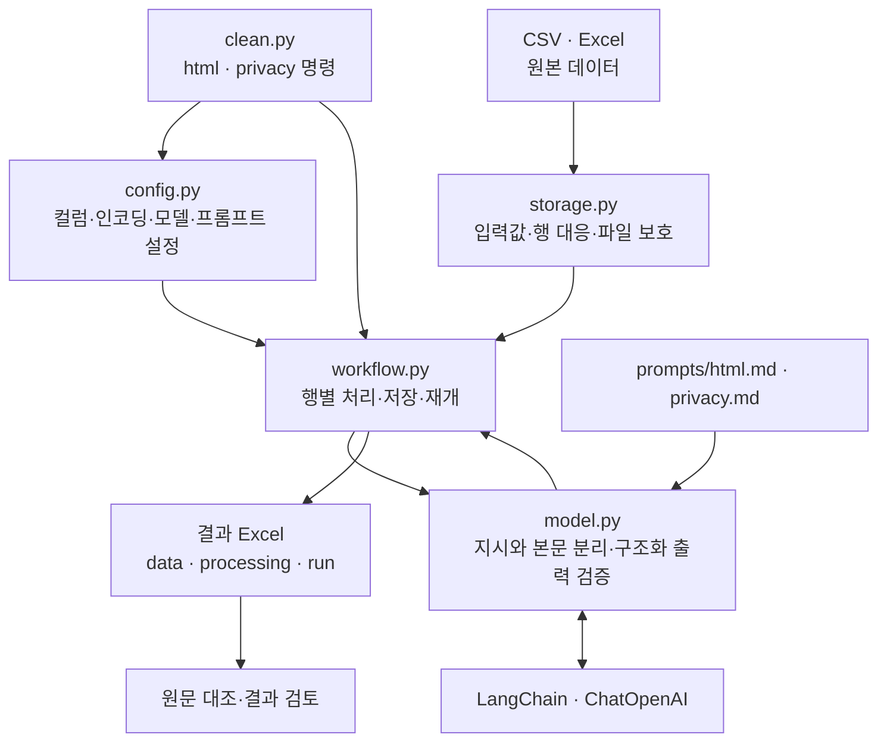

# 텍스트 데이터 정제

공감데이터 재직 중 **공공기관 간 공유할 DB 추출본의 장문 텍스트를 정리하는 데** 사용한 코드입니다. 게시글·공고문 본문에 섞인 HTML을 제거하고, 개인정보가 포함된 문구를 삭제하는 작업을 LangChain으로 보조합니다.

## 사용 목적과 업무 활용

메타관리시스템 기반 데이터 공유 업무에서는 기관 DB에서 공유 후보를 찾고, 보유 부서와 협의해 확보한 데이터를 검토·정제한 뒤 공유시스템에 등록했습니다. 이 과정에서 불필요·민감 컬럼, HTML·CSS, TEST 데이터, 정리되지 않은 값과 개인정보를 검토했습니다. 셀마다 긴 본문이 있는 컬럼에는 Python·LangChain을 활용했습니다.

이 폴더가 담당하는 범위는 **선택한 텍스트 컬럼의 HTML 제거와 개인정보 포함 문구 삭제**입니다. 공유 후보 선정·기관 협의·컬럼 삭제·TEST 데이터 판별·등록 전체를 자동으로 수행하는 도구는 아닙니다. 실제 업무 적용 설명은 [공유데이터 업무 기록](../reference/records/gonggam-data/work/shared-data.md)에 근거하며, 기관별 등록·평가 결과를 이 코드의 정제 정확도나 시간 절감 성과로 해석하지 않습니다.

| 작업 | 처리 목적 | 지시의 범위 |
| --- | --- | --- |
| `html` | 본문에서 HTML 양식을 제거하고 내용 추출 | 모델에 HTML 제거를 요청. 개인정보 삭제를 함께 수행한다고 가정하지 않음 |
| `privacy` | 공고문에서 개인정보가 포함된 문구 삭제 | 이름만 바꾸는 방식이 아니라 개인정보가 있는 문구 전체를 삭제하도록 요청 |

두 작업은 독립적으로 실행할 수 있으며, 필요하면 HTML 결과를 개인정보 정제로 연결할 수 있습니다. 모델의 처리 완료는 개인정보 삭제 완전성이나 내용 보존의 검토 완료를 뜻하지 않습니다. 결과는 원문과 대조해 업무 목적에 맞게 확인합니다.

## 코드 구조



## 간단한 실행

Python 3.13 환경에서 이 폴더를 작업 디렉터리로 사용합니다. 원본을 `inputs/`, 결과를 `outputs/`에 두고 실행합니다. 기본 본문 컬럼은 `내용`, CSV 인코딩은 `cp949`, Excel 시트는 첫 번째입니다.

```powershell
python -m pip install -r requirements.txt
python clean.py html --input inputs/data.csv --output outputs/html.xlsx
python clean.py privacy --input outputs/html.xlsx --output outputs/privacy.xlsx
```

CSV와 `.xlsx` 모두 입력할 수 있으며 출력은 `.xlsx`입니다. 다른 컬럼·인코딩·시트·모델을 사용하려면 `config.example.json`을 `config.local.json`으로 복사해 수정하고 `--config config.local.json`을 지정합니다. `prompt_path`를 설정하면 JSON 위치를 기준으로 사용자 프롬프트를 읽습니다. 프롬프트 파일에는 작업 지시만 작성하며 본문은 별도 사용자 메시지로 전달합니다.

- **모델·키:** 모델은 JSON `model` → `OPENAI_MODEL` 환경 변수 → 명시한 환경 파일 → 기본 `gpt-5.6-luna` 순서로 선택합니다. 실제 요청에는 `OPENAI_API_KEY`가 필요하며, 환경 변수를 우선하고 `--env-file`을 지정한 경우에만 해당 파일을 읽습니다. 빈 본문만 있으면 키가 필요하지 않습니다.
- **입력 보존:** CSV는 앞자리 0과 `NA` 등을 문자열로 유지합니다. Excel은 선택한 시트의 셀 값을 읽으며 서식·다른 시트를 복제하지 않습니다. 수식은 값으로 확정한 별도 입력을 사용합니다. 본문이 아닌 컬럼과 원본 파일은 변경하지 않습니다.
- **처리 제한:** 요청 제한 시간의 기본 설정은 60초이며 `timeout`으로 조정합니다. 자동 재시도는 하지 않습니다. Excel 셀 한도를 넘는 긴 값이나 저장할 수 없는 제어문자는 자동으로 잘라내지 않고 오류로 알립니다.
- **출력 보호:** 기존 경로를 자동 덮어쓰지 않습니다. 결과에는 선택한 데이터 시트와 처리 상태가 함께 들어 있습니다. 실패·대기 행의 `data`에는 원문이 남으므로 처리 상태를 확인한 뒤 사용합니다.

| 결과 시트 | 확인할 내용 |
| --- | --- |
| `data` | 원본 컬럼 구성을 유지한 데이터. 처리한 본문만 정제 결과로 교체 |
| `processing` | 원본 행 번호, 처리 상태, 정제 결과, 고정 오류 코드 |
| `run` | 원본·설정 식별 해시, 정제 방식·모델·대상 컬럼 등 재개 정보 |

`source_row`는 Excel 행 번호이며, CSV에서는 헤더를 1로 본 논리적 레코드 번호입니다. 따옴표 안의 줄바꿈은 하나의 레코드로 처리합니다. `completed`는 결과 저장 완료, `skipped`는 빈 입력, `review_required`는 빈 정제 결과, `error`는 실패, `pending`은 미처리입니다.

정제 결과 필드가 누락되거나 `None`이면 원문을 빈 값으로 덮어쓰지 않고 오류로 남깁니다. 빈 문자열 결과는 문구 전체를 제거한 정상 결과일 수도 있으므로 검토 대상으로 구분합니다. 오류는 첫 발생 행에서 중단하고, 검토 대상은 상태를 남긴 뒤 다음 행을 처리합니다.

중단한 작업은 같은 원본·설정으로 미완료 행만 재개합니다. 완료·검토 대상 행은 자동으로 다시 요청하지 않습니다.

```powershell
python clean.py html --input inputs/data.csv --output outputs/html.xlsx --resume
```

체크포인트를 재개할 때는 결과 파일을 다른 프로그램에서 수정하지 않습니다. 미완료·검토 대상이 남은 결과 파일을 다음 정제 단계에 그대로 연결하면 중단합니다. 사람이 결과를 확인·수정해 확정한 경우에는 `data` 시트의 값만 별도 Excel로 저장하여 사용하고, 재개용 체크포인트는 유지합니다.

종료 코드 `0`은 처리 완료, `1`은 오류·대기·검토 대상이 남음, `2`는 실행 실패입니다. 옵션은 `python clean.py html --help` 또는 `privacy --help`에서 확인합니다. 현재 코드의 실행 조건과 검증 한계는 [검증 기록](VALIDATION.md)에 정리했습니다.
